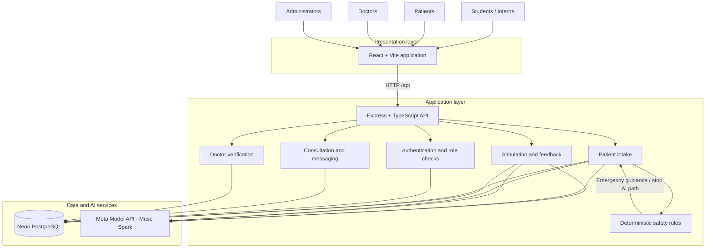
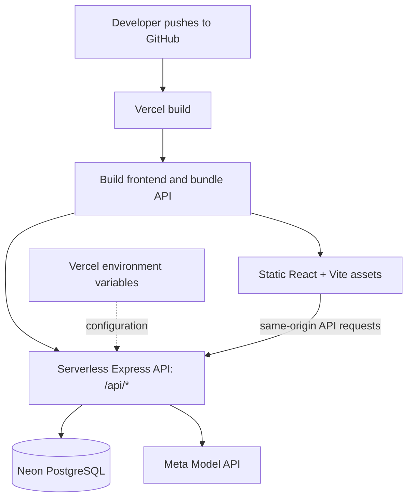
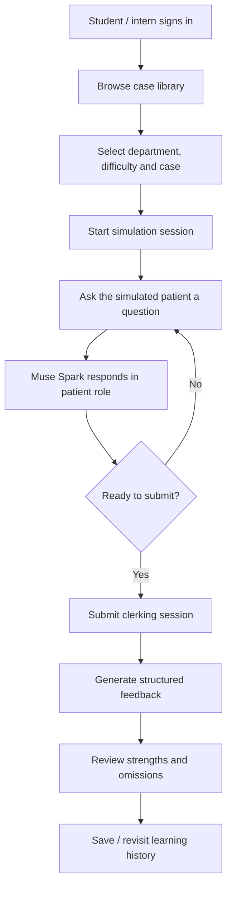
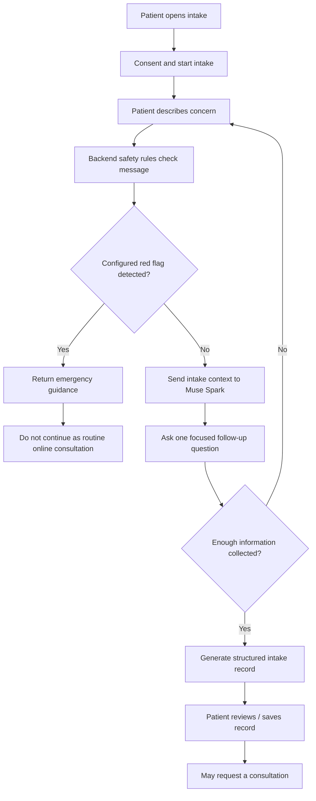
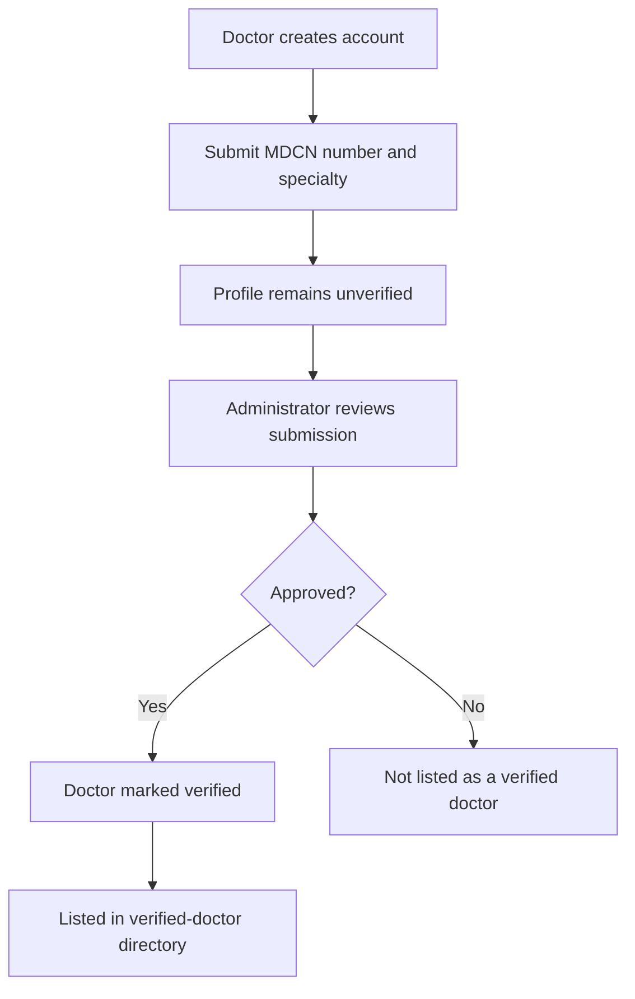
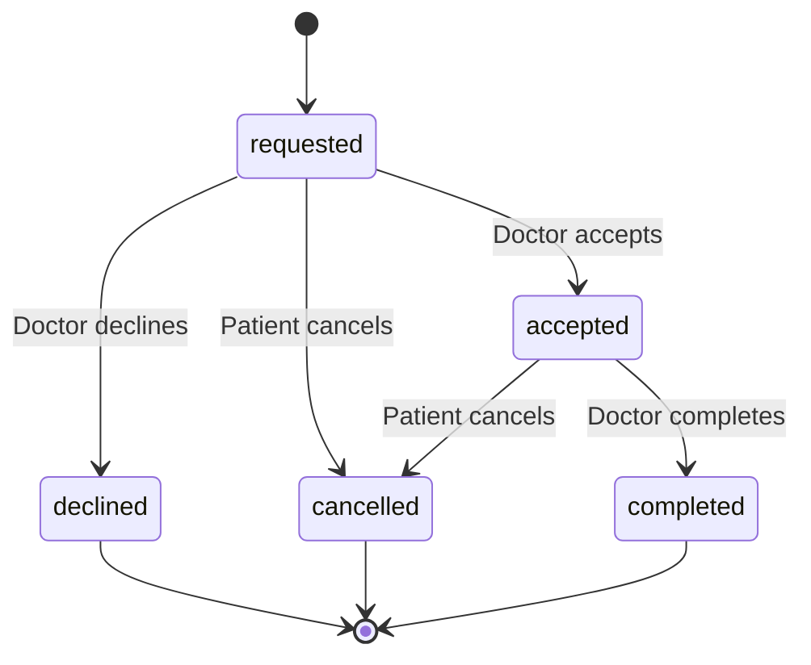
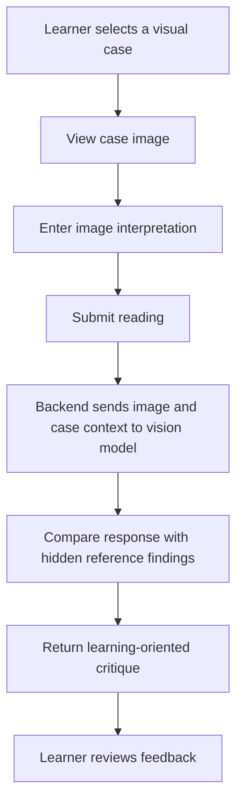

# ClerkifyDx

**AI-assisted clinical-skills training for medical students and structured patient intake for clinicians.**

ClerkifyDx is a bilingual clinical-learning and patient-intake prototype built for the Nigerian healthcare context. It combines an AI-driven simulated patient, structured clerking feedback, visual case practice, and a safety-first patient intake workflow in English and Nigerian Pidgin.

> **Project status:** Hackathon prototype for the Meta Global AI Developer Hackathon — *Build for Your World*.
>
> **Important safety notice:** ClerkifyDx is not a medical device and has not been clinically validated. It does not diagnose, prescribe, or replace a qualified healthcare professional. Patient-facing AI output is a preliminary summary for clinician review only. Do not submit real patient information to the public demo.

---

## Table of contents

- [1. Introduction](#1-introduction)
- [2. Problem statement](#2-problem-statement)
- [3. Goals and intended users](#3-goals-and-intended-users)
- [4. Core features](#4-core-features)
- [5. System architecture](#5-system-architecture)
- [6. Application modules](#6-application-modules)
- [7. Main workflows](#7-main-workflows)
- [8. Safety, privacy and access control](#8-safety-privacy-and-access-control)
- [9. Technology stack](#9-technology-stack)
- [10. Meta Model API integration](#10-meta-model-api-integration)
- [11. Project structure](#11-project-structure)
- [12. Getting started](#12-getting-started)
- [13. Environment configuration](#13-environment-configuration)
- [14. Demo accounts](#14-demo-accounts)
- [15. API reference](#15-api-reference)
- [16. Deployment](#16-deployment)
- [17. Current limitations](#17-current-limitations)
- [18. Roadmap](#18-roadmap)
- [19. Contributing](#19-contributing)
- [20. License](#20-license)

---

## 1. Introduction

Clinical clerking is a foundational skill in medical education. A learner must communicate with a patient, ask relevant questions, establish a timeline, identify important positive and negative findings, and organize the information into a coherent clinical history.

ClerkifyDx provides a practice environment in which medical students and interns can conduct simulated patient interviews without using a real patient as the practice subject. The simulated patient follows a predefined case and reveals information in response to relevant questions. After the encounter, the learner receives structured feedback about the history they obtained and the important details they missed.

The platform also addresses a separate point in the care pathway: the collection of a patient's initial history before a consultation. Patients can describe their concerns step by step in English or Nigerian Pidgin. A deterministic red-flag screening layer checks for configured emergency indicators before an AI request is made. When appropriate, the application can prepare a structured summary for a verified doctor.

The product therefore has two related but distinct workflows:

1. **Clinical education:** practice history-taking, review cases, and receive learning-oriented feedback.
2. **Patient intake:** collect a preliminary history, screen for configured emergency indicators, and support a clinician-reviewed consultation workflow.

## 2. Problem statement

Medical students in busy teaching hospitals may have limited opportunities for supervised, repeatable history-taking practice and individualized feedback. Learning on real wards is essential, but it is not always possible to pause, repeat an encounter, or receive detailed feedback after every interaction.

Patients can face a different challenge. They may reach an overstretched clinic without a structured account of their symptoms. Important information can be difficult to collect consistently, and patients who need urgent attention may be waiting in the same general queue. Language differences can make the first interaction harder, particularly for people who are more comfortable communicating in Nigerian Pidgin.

ClerkifyDx explores a technology-supported approach to both problems while keeping the role of AI limited and explicit.

## 3. Goals and intended users

### 3.1 Medical students and interns

- Practice structured history-taking through repeatable simulated encounters.
- Learn to ask focused questions instead of receiving the complete case history immediately.
- Compare their findings with the case reference and identify omissions.
- Review previous learning sessions and recurring gaps.

### 3.2 Patients

- Describe a health concern through a guided, one-question-at-a-time conversation.
- Communicate in English or Nigerian Pidgin.
- Receive emergency guidance when configured red-flag rules are triggered.
- Prepare a structured history that can be shared with a doctor through the consultation workflow.

### 3.3 Doctors

- Submit professional details for verification.
- Become visible in the patient-facing doctor directory only after approval.
- Review an intake summary after accepting a consultation request.
- Communicate with the patient within an accepted consultation.

### 3.4 Administrators

- Review doctor verification submissions.
- Approve or decline doctor profiles.
- Manage access to the verified-doctor directory through the approval workflow.

## 4. Core features

| Feature | Description |
|---|---|
| AI patient simulation | A model-powered simulated patient responds according to a hidden case script and reveals history as the learner asks questions. |
| Structured clerking feedback | The learner receives feedback on strengths, omissions, missed red flags, and clinical reasoning. |
| Case library | Text cases cover Paediatrics, Obstetrics, Surgery, and Internal Medicine, with department and difficulty filters. |
| Visual case practice | Learners interpret a chest X-ray or clinical image and receive AI-assisted critique against reference findings. |
| Patient intake | Guided, one-question-at-a-time history collection in English or Nigerian Pidgin. |
| Deterministic red-flag screening | Configured emergency indicators are checked in application code before any LLM request. |
| Structured clinician summary | The intake conversation can be converted into a summary intended for clinician review. |
| Doctor verification | Doctors submit an MDCN number and specialty for manual administrator review. |
| Consultation workflow | Patients can request consultations with verified doctors; doctors can accept, decline, or complete requests. |
| Consultation messaging | Patient and doctor can exchange messages after acceptance. |
| Learning history | Students and interns can revisit previous cases and review recurring omissions. |
| Demo access | The public demo can expose shared demo-account sign-in when demo seeding is enabled. |

## 5. System architecture

### 5.1 High-level architecture

ClerkifyDx uses a TypeScript monorepo with a React + Vite frontend and an Express + TypeScript backend. In the Vercel deployment, the frontend is served as a static application and the API is exposed through a serverless function under the same origin. Persistent application data is stored in Neon PostgreSQL.

The backend separates authentication, role and consultation operations, deterministic safety checks, and model interactions into dedicated modules.



### 5.2 Layered system view

| Layer | Responsibility | Main components |
|---|---|---|
| Presentation | User interaction and role-specific screens | React, Vite |
| Application | Request handling, authentication, workflows, validation | Express, TypeScript, Zod |
| Safety | Deterministic screening of configured red flags | `safety.ts` |
| AI integration | Simulated patient, feedback, visual critique, intake conversation | `llm.ts`, Meta Model API |
| Data | Persistent users, cases, sessions, records, and consultation data | Neon PostgreSQL |

### 5.3 Request lifecycle

1. A user interacts with the React application.
2. The frontend sends an HTTP request to the Express API under `/api`.
3. The backend validates request data and checks authentication and role permissions where required.
4. The relevant application module performs the requested operation.
5. If model assistance is needed, the backend calls the shared model client. Patient intake first passes through deterministic safety screening.
6. The backend persists or retrieves application data from PostgreSQL and returns a response to the frontend.

### 5.4 Deployment architecture



The repository's `vercel.json` and `npm run build:vercel` workflow configure the combined deployment. The API bundle is generated into `api/index.js`; the build regenerates it, while the committed bundle is retained as a fallback.

## 6. Application modules

### 6.1 Authentication and authorization

Handles account registration, login, current-user retrieval, password hashing, JWT-based authentication, and role-aware access. Protected operations must enforce permissions on the backend rather than relying only on frontend visibility.

### 6.2 Case library

Provides the clinical cases available for practice. The current text-case library includes 11 cases across Paediatrics, Obstetrics, Surgery, and Internal Medicine. Department and difficulty filters help learners select an appropriate case.

### 6.3 Patient simulation

Creates a learning session around a selected case. The model receives the simulation context and hidden case script, then responds as the patient. The simulated patient is intended to reveal information when asked rather than disclose the entire history at the beginning.

### 6.4 Clerking feedback

Evaluates the learner's completed interview and returns structured learning feedback, including strengths, omissions, missed red flags, and reasoning-related observations. Feedback is educational and may be inaccurate; it is not a clinical assessment of a real patient.

### 6.5 Visual case assessment

Allows a learner to submit their interpretation of a case image. The vision-capable model critiques the reading against hidden reference findings and can flag a likely mismatch between the image and the case. Visual cases appear only when the corresponding image assets have been added.

### 6.6 Patient intake and safety screening

Collects a patient's concern in a guided conversation. The backend checks configured red-flag indicators in deterministic application code before calling the model. If an emergency indicator is detected, the safety path takes precedence over the AI conversation. Otherwise, the intake workflow can continue and produce a structured preliminary record.

### 6.7 Doctor verification

Doctors submit their MDCN number and specialty for manual review. New doctor accounts are unverified by default. The public doctor directory lists verified doctors only.

### 6.8 Consultation management

Coordinates the consultation request lifecycle. The doctor must accept a request before the patient summary is exposed to that doctor through the consultation workflow. The doctor can accept, decline, or complete a request; the patient can cancel a request.

### 6.9 Consultation messaging

Provides messaging between the patient and doctor after a consultation has been accepted. Messages are restricted to consultation participants. The current implementation uses polling rather than WebSockets.

### 6.10 Learning history and patient records

Students and interns can retrieve their learning history, including previous sessions and recurring omissions. Patients can retrieve their saved intake records through their own account.

### 6.11 Administration

Provides the doctor-review workflow used by administrators to approve or decline submitted professional profiles.

## 7. Main workflows

### 7.1 Student clerking simulation

The simulation is designed to behave like a patient interview rather than a static question-and-answer sheet.



### 7.2 Patient intake and red-flag screening

The order of operations is intentional: deterministic emergency screening is performed before an LLM request. Emergency handling does not depend on model output or model availability.



### 7.3 Doctor verification



### 7.4 Consultation lifecycle



The application uses explicit consultation states so that a request is not represented as accepted or reviewed before the doctor actually accepts it. The patient summary is made available to the doctor only after acceptance. Messaging is available to the consultation participants after acceptance.

### 7.5 Visual case workflow



Visual cases depend on reviewed and appropriately licensed image assets being present in `backend/assets/cases/`. See `backend/assets/cases/README.md` for asset instructions.

## 8. Safety, privacy and access control

Safety is a core design constraint, especially in the patient-facing workflow.

### 8.1 AI is not used for emergency detection

- Configured red-flag checks run in backend application code before an AI call.
- Emergency guidance does not depend on the LLM, model response, or network availability.
- Emergency intakes are not treated as routine online consultations.
- The red-flag rules are a prototype and have not been clinically validated.

### 8.2 No AI diagnosis

- Patient intake produces a preliminary structured history for clinician review.
- The application does not present the intake model as a diagnosing clinician.
- Simulation feedback is for education, not patient care.
- Model output can be incomplete, misleading, or wrong.

### 8.3 Role and account protections

- Passwords are hashed using bcrypt.
- Authentication uses JWT.
- Backend routes apply role-aware access checks.
- Request input is validated with Zod.
- Rate limiting and Helmet are used as part of API hardening.
- Doctors are unverified by default and require administrator approval before appearing in the verified directory.
- Consultation messages are restricted to participants.

### 8.4 Patient-data caution

The public deployment is a demonstration environment. Do not enter real patient identifiers, medical records, or other sensitive health information. The prototype is not presented as a compliant production clinical-record system.

## 9. Technology stack

| Area | Technology | Purpose |
|---|---|---|
| Frontend | React | User interface |
| Frontend tooling | Vite | Development server and production build |
| Language | TypeScript | Typed application code |
| Backend | Node.js + Express | HTTP API and application workflows |
| Database | Neon PostgreSQL | Persistent application data |
| AI model | Meta Muse Spark via Meta Model API | Patient simulation, feedback, visual critique, and guided intake |
| AI client | OpenAI-compatible Chat Completions API | Shared model integration |
| Authentication | JWT | Authenticated sessions |
| Password security | bcrypt | Password hashing |
| Validation | Zod | Request-data validation |
| API security | Helmet and rate limiting | Security headers and request throttling |
| Deployment | Vercel | Static frontend and serverless API |
| Build | esbuild | API bundling for Vercel |

## 10. Meta Model API integration

ClerkifyDx uses the Meta Model API through a shared backend client in `backend/src/llm.ts`. The configured model is `muse-spark-1.3`, accessed through the OpenAI-compatible Chat Completions endpoint:

`https://api.meta.ai/v1/chat/completions`

| Application capability | Backend module | Model responsibility |
|---|---|---|
| Simulated patient | `backend/src/simulation.ts` | Role-play a patient using a hidden case script and reveal history in response to questions. |
| Clerking feedback | Simulation workflow | Return structured JSON feedback on strengths, omissions, missed red flags, and reasoning. |
| Visual case feedback | `backend/src/visual.ts` | Analyze a submitted case image and critique the learner's interpretation against reference findings. |
| Patient intake | `backend/src/triage.ts` | Continue a one-question-at-a-time intake conversation in English or Nigerian Pidgin and help prepare a structured record. |

The model configuration uses the Standard-mode model ID, `muse-spark-1.3`, rather than the `-contributor` variant. The model API key is held by the backend and must never be exposed in frontend code or committed to the repository.

When `MODEL_API_KEY` is absent, or `MOCK_LLM=true`, the backend can use mock responses so that the application interface and basic workflows can be explored without live model calls.

## 11. Project structure

The repository is organized as an npm-workspaces TypeScript monorepo.

```text
ClerkifyDx/
├── api/
│   └── index.js                 # Generated Vercel API bundle / fallback
├── backend/
│   ├── assets/
│   │   └── cases/               # Visual case assets and instructions
│   ├── src/
│   │   ├── llm.ts               # Shared Meta Model API client
│   │   ├── safety.ts            # Deterministic red-flag screening
│   │   ├── simulation.ts        # Simulated patient and clerking workflow
│   │   ├── triage.ts            # Patient intake workflow
│   │   └── visual.ts            # Visual case analysis
│   ├── .env.example             # Backend environment template
│   └── ...
├── frontend/
│   └── ...                      # React + Vite client
├── vercel.json                  # Vercel routing and build configuration
├── package.json                 # Root scripts and npm workspaces
└── README.md
```

Some generated or deployment-specific files may be present in addition to this overview. The source modules under `backend/src/` are the primary place to inspect the corresponding backend workflows.

## 12. Getting started

### 12.1 Prerequisites

- Node.js 22 or later
- npm
- A Neon PostgreSQL database
- A Meta Model API key for live AI responses

### 12.2 Clone the repository

```bash
git clone https://github.com/Eman2123/ClerkifyDx.git
cd ClerkifyDx
npm install
```

### 12.3 Configure the backend

Copy the example environment file:

```bash
cp backend/.env.example backend/.env
```

Add your database connection string, a long random JWT secret, and your Meta Model API key. See [Environment configuration](#13-environment-configuration).

### 12.4 Seed local demo accounts

```bash
npm run seed
```

The seed command creates local demo accounts. It refuses to run when `NODE_ENV=production`.

### 12.5 Start the backend

```bash
npm run dev:backend
```

The local backend is expected at:

`http://localhost:4000`

### 12.6 Start the frontend

Open a second terminal from the repository root:

```bash
npm run dev:frontend
```

The Vite frontend is expected at:

`http://localhost:5173`

## 13. Environment configuration

| Variable | Default | Required / purpose |
|---|---|---|
| `DATABASE_URL` | None | Required. Neon PostgreSQL connection string; use the SSL-enabled connection string. |
| `MODEL_API_KEY` | None | Meta Model API key. Without it, the application can run in mock mode. |
| `MODEL_API_BASE_URL` | `https://api.meta.ai/v1` | Base URL for the Meta Model API. |
| `MODEL_NAME` | `muse-spark-1.3` | Model identifier. |
| `MODEL_REASONING_EFFORT` | Unset | Optional model reasoning configuration. |
| `JWT_SECRET` | Development placeholder | Set a long, random secret for deployment. |
| `ADMIN_EMAIL` | Unset | Optional initial administrator email. |
| `ADMIN_PASSWORD` | Unset | Optional initial administrator password. |
| `CORS_ORIGIN` | `http://localhost:5173` | Allowed frontend origin(s), comma-separated. |
| `ALLOW_DEMO_SEED` | Unset | Set to `true` for the public demo to seed shared demo accounts and show demo sign-in buttons. |
| `VITE_API_URL` | Empty | Frontend API origin when the backend is hosted separately. |

**Security:** Never commit `backend/.env`, API keys, database credentials, or production secrets. Keep secrets in the deployment platform's environment-variable settings.

## 14. Demo accounts

Running `npm run seed` locally creates the following demo accounts. The demo password is `Demo12345`.

| Role | Email |
|---|---|
| Student | `student@clerkifydx.demo` |
| Intern | `intern@clerkifydx.demo` |
| Patient | `patient@clerkifydx.demo` |
| Doctor | `doctor@clerkifydx.demo` |

To create the initial administrator, configure `ADMIN_EMAIL` and `ADMIN_PASSWORD` before starting the backend.

These are demonstration credentials, not credentials for real users. Do not reuse the demo password.

## 15. API reference

All endpoints are served under the `/api` prefix.

### 15.1 Health and authentication

| Method | Endpoint | Purpose |
|---|---|---|
| GET | `/api/health` | Check API status and model configuration. |
| POST | `/api/auth/register` | Register an account. |
| POST | `/api/auth/login` | Authenticate an account. |
| GET | `/api/auth/me` | Retrieve the current authenticated user. |

### 15.2 Learning and case simulation

| Method | Endpoint | Purpose |
|---|---|---|
| GET | `/api/me/learning` | Retrieve student/intern learning history. |
| GET | `/api/cases` | List available clinical cases. |
| POST | `/api/simulation/start` | Start a simulation session. |
| POST | `/api/simulation/:id/message` | Send a question to the simulated patient. |
| POST | `/api/simulation/:id/submit` | Submit a session and request structured feedback. |
| GET | `/api/simulation/:id` | Resume or review a previous case. |
| POST | `/api/simulation/:id/image-read` | Submit an interpretation for visual-case feedback. |

### 15.3 Patient intake and records

| Method | Endpoint | Purpose |
|---|---|---|
| POST | `/api/triage/start` | Record consent and start an intake. |
| POST | `/api/triage/:id/message` | Continue intake; the backend screens for configured red flags. |
| POST | `/api/triage/:id/record` | Generate a structured clinician summary. |
| GET | `/api/me/records` | Retrieve saved intake records for the patient. |

### 15.4 Doctor verification and consultations

| Method | Endpoint | Purpose |
|---|---|---|
| POST / GET | `/api/doctor/profile` | Submit or retrieve doctor verification details. |
| GET | `/api/admin/doctors` | List doctor profiles for administrator review. |
| POST | `/api/admin/doctors/:id/review` | Approve or decline a doctor verification submission. |
| GET | `/api/doctors` | List verified doctors for patients. |
| POST / GET | `/api/consultations` | Create a consultation request or list accessible consultations. |
| POST | `/api/consultations/:id/respond` | Doctor accepts, declines, or completes a consultation. |
| POST | `/api/consultations/:id/cancel` | Patient cancels a consultation request. |
| GET / POST | `/api/consultations/:id/messages` | Read or send messages in an accepted consultation. |

The API list summarizes the currently documented routes. Authentication and role permissions apply to protected operations. Consult the backend route implementation for request schemas and exact response payloads.

## 16. Deployment

The live-demo architecture is designed to run from one Vercel project:

- React frontend is built and served as static assets.
- Express API is bundled into a serverless function and exposed under `/api/*`.
- Neon PostgreSQL stores application data.
- The backend calls the Meta Model API when live model configuration is available.

### 16.1 Create a Neon database

1. Create a Neon project and database.
2. Copy the pooled connection string.
3. Ensure the connection string includes SSL configuration, for example `?sslmode=require`.
4. Store it as `DATABASE_URL` in Vercel.

### 16.2 Configure the Meta Model API

1. Create a Model API key through [Meta AI Developer](https://dev.meta.ai).
2. Add the key to Vercel as `MODEL_API_KEY`.
3. Keep the key server-side. Do not add it to a `VITE_*` variable or frontend source.

### 16.3 Import the repository into Vercel

1. Select **Add New → Project** and import this repository.
2. Keep the root directory set to the repository root.
3. Use the repository's `vercel.json` build and routing configuration.
4. Add the environment variables below.

| Variable | Deployment value |
|---|---|
| `DATABASE_URL` | Neon pooled connection string |
| `MODEL_API_KEY` | Meta Model API key |
| `JWT_SECRET` | Long, random secret |
| `ALLOW_DEMO_SEED` | `true` only when enabling shared public demo accounts |

5. Deploy the project.
6. Open `https://<your-app>.vercel.app/api/health` and verify the response. For live model mode, `mockLlm` should be `false`.

### 16.4 Build command

The repository provides:

```bash
npm run build:vercel
```

This bundles the API into `api/index.js` and builds the frontend. Vercel regenerates the bundle during the build.

### 16.5 Public demo warning

When `ALLOW_DEMO_SEED=true`, shared demo accounts are seeded and the interface can show demo sign-in buttons. Shared accounts are for evaluation only. Do not enter real patient data into the public demo.

## 17. Current limitations

ClerkifyDx is a prototype. The following limitations are important when evaluating or extending it:

- **No clinical validation:** the application, case library, and red-flag rules have not yet been reviewed and validated by a clinical panel.
- **Model reliability:** simulated-patient behavior, intake prompts, and feedback may be inaccurate or incomplete.
- **Not an emergency service:** the application is not an emergency channel and must not delay seeking urgent in-person care.
- **Visual case assets:** visual cases require reviewed and appropriately licensed image files to be added by the maintainer.
- **Consultation messaging:** chat uses approximately four-second polling; it does not currently provide WebSockets, push notifications, read receipts, or file sharing.
- **No video consultation:** video calling is not implemented.
- **Manual doctor verification:** the administrator checks a self-reported MDCN number; there is no automated registry lookup.
- **Pidgin evaluation:** Nigerian Pidgin support is prompt-based and has not been evaluated with native-speaker clinicians.
- **Database migrations:** tables are created at startup using `CREATE TABLE IF NOT EXISTS`; a formal migration tool is not yet configured. Future schema changes may require manual SQL or adoption of a migration library.
- **Prototype data handling:** the public demo is not intended for real patient information or production clinical records.

## 18. Roadmap

Potential next steps include:

- WebSocket-based consultation messaging and real-time updates.
- Video consultation support.
- Appointment scheduling and reminders.
- Clinically reviewed case library and triage protocols.
- Expanded visual case collection with properly licensed assets.
- Voice-based intake using Muse Voice Transcribe.
- Referral workflows that help patients find appropriate hospitals.
- Native-speaker evaluation and improvement of Nigerian Pidgin interactions.
- Formal database migrations and stronger production data-governance controls.

## 19. Contributing

Contributions, issue reports, and technical suggestions are welcome.

1. Fork the repository.
2. Create a focused feature branch.
3. Install dependencies and configure local environment variables.
4. Make and test your changes.
5. Open a pull request with a clear description of the problem and implementation.

For changes involving patient intake, emergency screening, doctor verification, or consultation access, explain the safety and authorization implications in the pull request. Do not include real patient data in issues, commits, screenshots, or test fixtures.

## 20. License

This project is licensed under the MIT License. See [LICENSE](LICENSE) for details.

---

**Built for the Nigerian healthcare context. Designed to support clinical learning and more structured intake — with clear boundaries between AI assistance and professional medical judgment.**
